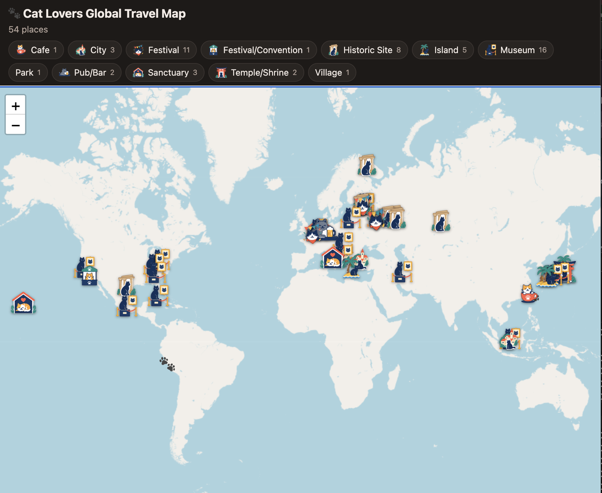

# Cat Map Project




Cat-related places around the world, as a live web map and a KML file for Google My Maps. Custom icon per place type.

Live map: https://nazelizurna.github.io/cat-map-project/

Google Maps: https://www.google.com/maps/d/edit?mid=1y0c3q_vG4JOmr3z0xNpvdW7b1BO8dnY&usp=sharing

## Files

| File | Purpose |
|---|---|
| `cat_places.csv` | The data. Edit this. |
| `make_cat_kml.py` | Builds `cat_places.kml` from the CSV. |
| `cat_places.kml` | Generated. Import into Google My Maps. |
| `index.html` | The web map (GitHub Pages). Reads the CSV directly. |
| `assests/` | Icon PNGs, one per place type. |
| `.github/workflows/build-kml.yml` | Rebuilds the KML when the CSV changes. |

## Add a place

1. Open `cat_places.csv` on GitHub, click the pencil icon.
2. Add a row. Leave `Lat` and `Lon` empty:
   ```
   Cat Cafe Example,Paris,France,Cafe,"1 Rue Example, Paris, France",,
   ```
3. Commit.

GitHub Actions looks up the coordinates, saves them to the CSV, and rebuilds the KML. The web map updates after Pages redeploys (a few minutes).

Check new pins. Address lookup is sometimes wrong. To fix one, type the correct `Lat` and `Lon` in the CSV.

## CSV columns

`Name, Location, Country, Type, Address, Lat, Lon`

`Type` must be one of:

`City`, `Island`, `Village`, `Sanctuary`, `Museum`, `Park`, `Historic Site`, `Temple/Shrine`, `Pub/Bar`, `Cafe`, `Festival`, `Festival/Convention`

Edit the file as plain text. TextEdit's default rich text format breaks it (use Format → Make Plain Text), or use Numbers/Excel and export as CSV.

## Use in Google My Maps

Requires import by hand:

1. Download `cat_places.kml` (open it in the repo, click Raw, save).
2. Go to [mymaps.google.com](https://mymaps.google.com) → Create a new map → Import.
3. Upload the file.

To update later: import the new file as a new layer, then delete the old layer.

## New place type

1. Add the icon PNG to `assests/`.
2. Add a line to `TYPES` in `make_cat_kml.py`.
3. Add a line to `ICONS` in `index.html`.

## Run locally

```
pip install geopy
python make_cat_kml.py --geocode
python -m http.server     # open http://localhost:8000
```

Options: `-i` input CSV, `-o` output KML, `--geocode` fill missing coordinates.

## Setup (one time)

- Settings → Pages → Deploy from a branch → `main` / root.
- Settings → Actions → General → Workflow permissions → Read and write.

## Notes

- Icons load from `raw.githubusercontent.com`, so the repo must be public.
- Map tiles: OpenStreetMap. Geocoding: OpenStreetMap Nominatim.
